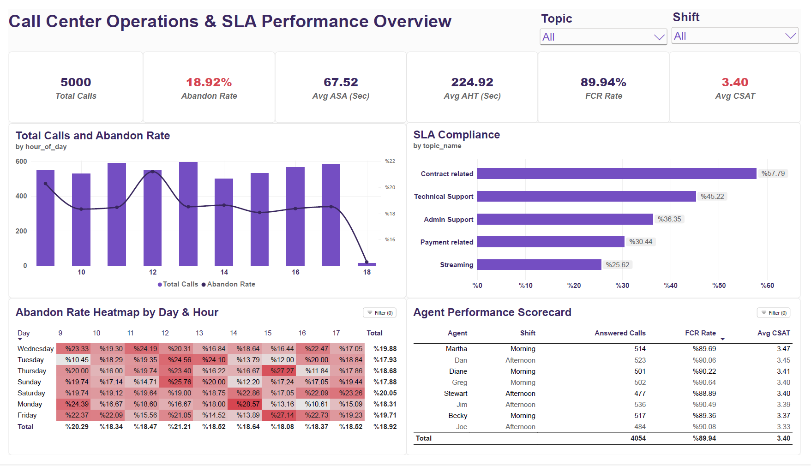

# Call Center SLA and Agent Performance Analysis (SQL, Excel, Power BI)

A data analytics project built to practice working with a full pipeline, from raw data all the way to a finished dashboard. I used a mock call center dataset of 5,000 calls and tried to understand how the call center is really performing. How many calls get abandoned, how fast calls get answered, which topics struggle with their SLA targets, and how individual agents compare.



---

## What I Wanted to Find Out

I built this project around four simple questions.

1. **Overall performance.** What do the basic numbers look like? Abandon rate, average speed of answer (ASA), average handle time (AHT), first call resolution (FCR), and CSAT.
2. **Time patterns.** Are there specific hours or days when more calls get abandoned?
3. **SLA by topic.** Do some call topics struggle more than others to meet their SLA target?
4. **Agent performance.** How do individual agents compare on call volume, FCR, and CSAT, across Morning and Afternoon shifts?

---

## Tools and Data Structure

I used Claude to write the Python (pandas) scripts that clean the raw data, build the star schema, and generate the KPI summary workbook, based on a specification I gave it. Then I used SQL to check my numbers and explore the data further. After that I built a KPI summary in Excel with live formulas, and finally put everything together in an interactive Power BI dashboard.

**Data model**
* `fact_calls` (5,000 rows). One row per call, with the hour and day of the call, whether it was answered, how long the customer waited, how long the call lasted, whether it was resolved on the first try, and the CSAT score.
* `dim_agents`. Agent names and their shift (Morning or Afternoon).
* `dim_topics`. The call topics (Contract related, Technical Support, Admin Support, Payment related, Streaming), each with its own `sla_target_sec` column holding the SLA target in seconds for that topic.

---

## What I Found

* **Overall numbers.** Out of 5,000 calls, 4,054 were answered, which works out to an abandon rate of 18.92%. Average ASA is 67.52 seconds, average AHT is 224.92 seconds, FCR is 89.94%, and average CSAT is 3.40 out of 5.
* **Time patterns.** Abandonment peaks around 12:00 (21.21%), which is also one of the busiest hours of the day (around 550 calls, confirmed directly from the data). Looking at day and hour together, a few single cells stand out even more: Monday at 14:00 (28.57%), Thursday at 15:00 (27.27%), Friday at 15:00 (27.14%), and Sunday at 12:00 (25.76%). With this amount of data, some of these spikes could just be noise rather than a real pattern, but they seemed worth flagging. I also noticed the 18:00 hour barely has any calls, so I filtered it out of the heatmap to avoid one lonely data point looking misleading.
* **SLA by topic.** Contract related calls have the best SLA compliance at 57.79%, then Technical Support at 45.22%, then Admin Support at 36.35%. Payment related (30.44%) and Streaming (25.62%) are the lowest. This also lines up with how strict each topic's SLA target is. A looser target is naturally easier to hit.
* **Agent performance.** All 8 agents have fairly similar FCR rates, between 88.89% and 90.64%. CSAT varies a little more, between 3.33 and 3.47. Martha and Dan have the highest CSAT while also handling a high number of calls.

---

## Things Worth Looking Into Further

These are just things I noticed in the data, not firm conclusions, since I don't have the full operational context behind them.

* The abandonment spikes around midday and some afternoon hours might be related to staffing or breaks. It would be interesting to check this against real shift schedules.
* Streaming and Payment related calls have the lowest SLA compliance. It could be worth checking if these calls wait longer in queue or need better self-service options.
* The CSAT gap between agents is small but consistent. Some peer learning between the higher and lower CSAT agents could be a simple thing to try, especially since FCR is already similar across the team.

---

## Repository Structure

```text
call-center-sla-analytics/
├── README.md
├── data/
│   ├── raw/
│   │   └── Call-Center-Dataset.xlsx
│   └── processed/
│       ├── fact_calls.csv
│       ├── dim_agents.csv
│       └── dim_topics.csv
├── scripts/
│   ├── build_star_schema.py
│   └── build_kpi_excel.py
├── sql/
│   └── call_center_analysis.sql
├── excel/
│   └── call_center_kpi_summary.xlsx
└── powerbi/
    ├── call_center_dashboard.pbix
    └── dashboard_preview.png
```

---

## Notes

This was a learning project, so I kept the SQL and the dashboard simple and easy to follow on purpose. Along the way I also ran into a few real Power BI formatting issues and had to figure out how to fix them. A locale and decimal separator mismatch made some number columns come in 10 times too large when importing the CSVs. The new Card visual's display units setting did not behave as expected and needed a visual reset to show up correctly. And percentages showed up with the percent sign in the wrong place because of a locale and display language setting.
